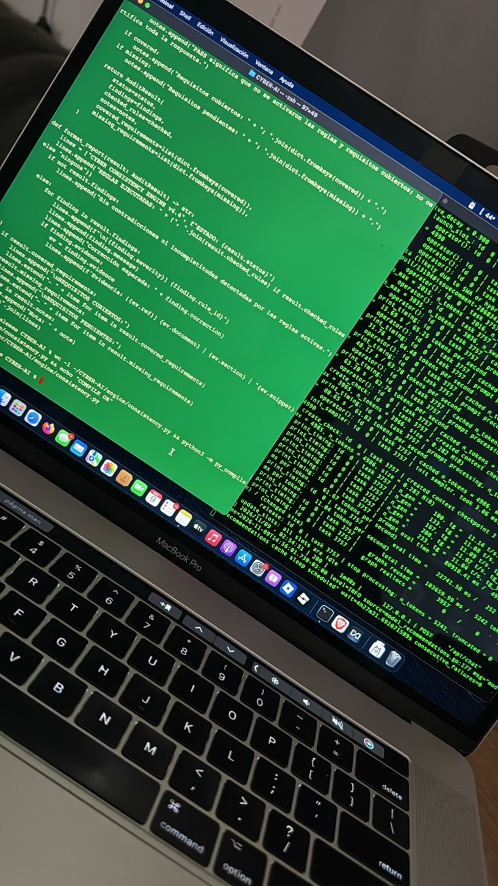
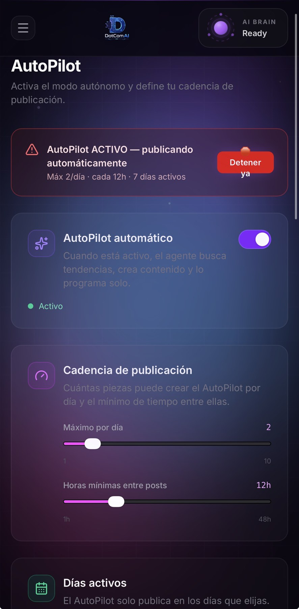
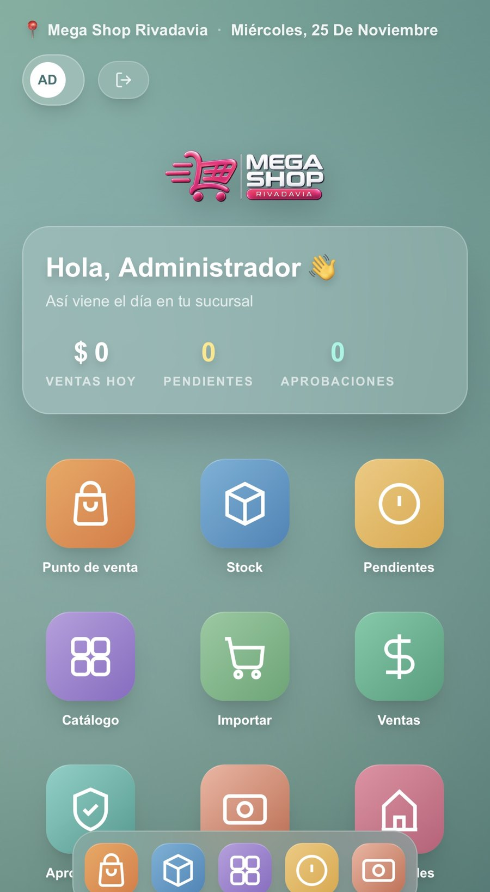

# Emanuel Moreno Di Cesare

Software Architect | AI Systems Engineer | Cybersecurity Researcher

I'm a software developer and architect based in Mendoza, Argentina. Through [DOTCOM](https://www.bydotcom.com), I build business applications, autonomous AI workflows and local cybersecurity tools. I work across the application, backend and database layers, with particular attention to authorization, reliability and testing.

Most of my current projects are private. I've made their architecture notes, selected test results and actual product screenshots available here.

## Selected projects

| [CYBER-AI / SENTINEL-AI](showcase/cyber-intelligence.md) | [AutoPilot AI](showcase/autopilot.md) | [MegaShop](showcase/enterprise-saas.md#retail-systems) |
| :---: | :---: | :---: |
|  |  |  |

[More project screenshots and development photos](portfolio-media/README.md)

**[CYBER-AI / SENTINEL-AI](showcase/cyber-intelligence.md)** — Local cybersecurity assistant with hybrid retrieval, NLI-based evidence validation and a provenance gate. I'm integrating it with an ARTEX-based security testing platform. An earlier HTTP bridge integration run recorded 44 passing tests, including 17 HTTP-specific cases.

**[AutoPilot AI](showcase/autopilot.md)** — Marketing SaaS with brand context, configurable agent autonomy, model fallback and publishing workflows. Its scheduled pipeline, publishing and YouTube jobs have completed successfully in GitHub Actions.

**[MegaShop](showcase/enterprise-saas.md#retail-systems)** — Retail management, inventory and AI-assisted product intake from spreadsheets and document photos. The planned connection to AutoPilot would use market trends and available inventory to prepare product promotions. [Public repository](https://github.com/emamoreno7/Gestion-Inteligente-MegaShop).

**[GYM OS](showcase/enterprise-saas.md#gym-os)** — Multi-tenant gym management pilot, covering memberships, payments, QR access and supervised training programs. Isolated PostgreSQL integration checks passed for tenant RLS, billing and QR access.

**[Mobile security and privacy](showcase/mobile-security.md)** — DOTCOM OS is an architecture research project focused on mobile data protection. EmA is an early native Android prototype for processing financial notifications locally.

The test results above refer to particular development runs. The project notes explain their scope and what still needs validation.

## Technical focus

- **AI systems:** Python, local LLMs, Ollama, hybrid RAG, NLI, ONNX Runtime, model routing and agent orchestration.
- **Full-stack and backend:** TypeScript, Next.js, React, API design, PostgreSQL, Supabase and SQLite.
- **Security and reliability:** RLS, role-based access control, transactional workflows, evidence provenance and automated testing.
- **Mobile and delivery:** Kotlin, Jetpack Compose, Vercel and GitHub Actions.

## Code example

[Service profitability calculations and tests](examples/README.md) — a small TypeScript module from the aesthetic center application, with eight reproducible unit tests added during the portfolio review.

## Public repositories

[DOTCOM website](https://github.com/emamoreno7/dotcom-software-solutions) · [MegaShop retail management](https://github.com/emamoreno7/Gestion-Inteligente-MegaShop) · [Aesthetic center management](https://github.com/emamoreno7/sistema-estetica)

For software architecture, applied AI, backend engineering opportunities or collaborations, you can reach me through [bydotcom.com](https://www.bydotcom.com).
