# Project screenshots

[Back to profile](../README.md)

These are screenshots and photographs from my development work, not product mockups. The screenshots have been resized for the web; the setup token and local account label in the SENTINEL-AI photograph have been masked.

## AutoPilot AI

[Architecture and workflow notes](../showcase/autopilot.md)

| Dashboard | Agent controls | Model providers |
| :---: | :---: | :---: |
|  | [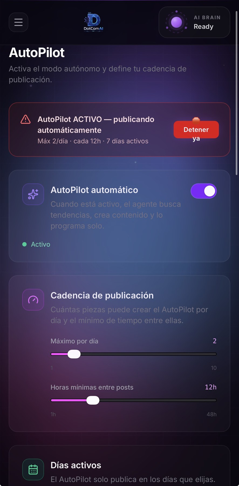](autopilot/agent-controls.jpg) |  |
| Account overview | Posting cadence and manual stop | Primary provider and fallback order |

| Brand context | Scheduling | Content library |
| :---: | :---: | :---: |
| [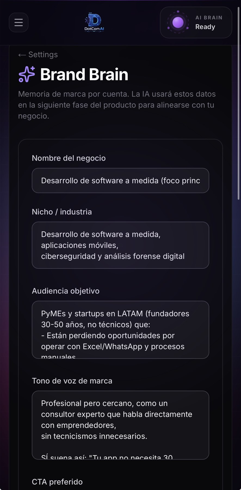](autopilot/brand-brain.jpg) | [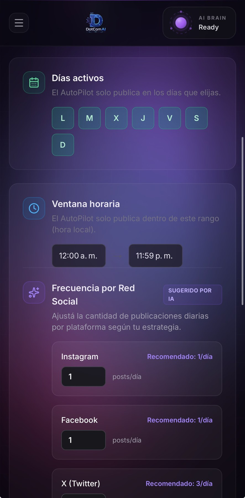](autopilot/schedule.jpg) | [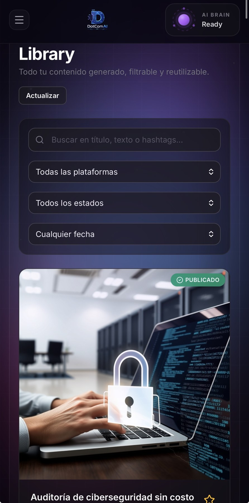](autopilot/library.jpg) |
| Per-account brand configuration | Active days and time windows | Content filtering and status |

| Trends | Billing and usage |
| :---: | :---: |
| [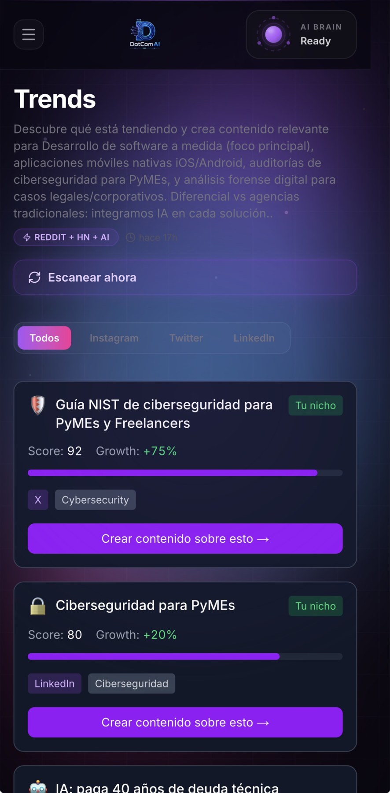](autopilot/trends.jpg) | [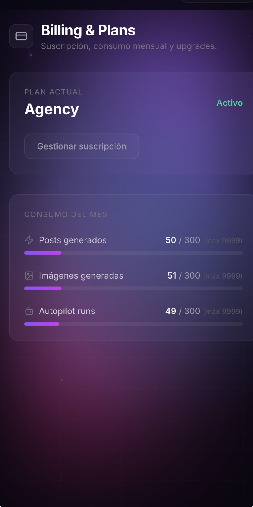](autopilot/billing.jpg) |
| Topic discovery | Subscription and usage counters |

The figures and statuses in these screenshots are what the application displayed at capture time, not independently audited performance or publishing results.

## CYBER-AI / SENTINEL-AI

[Architecture and evidence validation notes](../showcase/cyber-intelligence.md)

Most of this work happens in the terminal. These photos are a record of development and setup, not a benchmark or a test report.

| Local backend setup | Consistency engine | Intel build work |
| :---: | :---: | :---: |
| [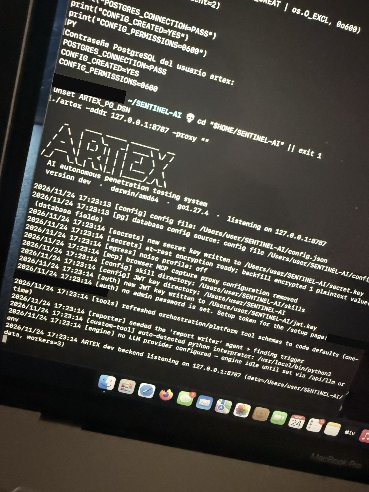](cyber-ai/sentinel-startup.jpg) | [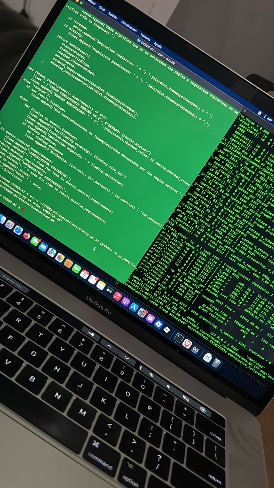](cyber-ai/consistency-development.jpg) | [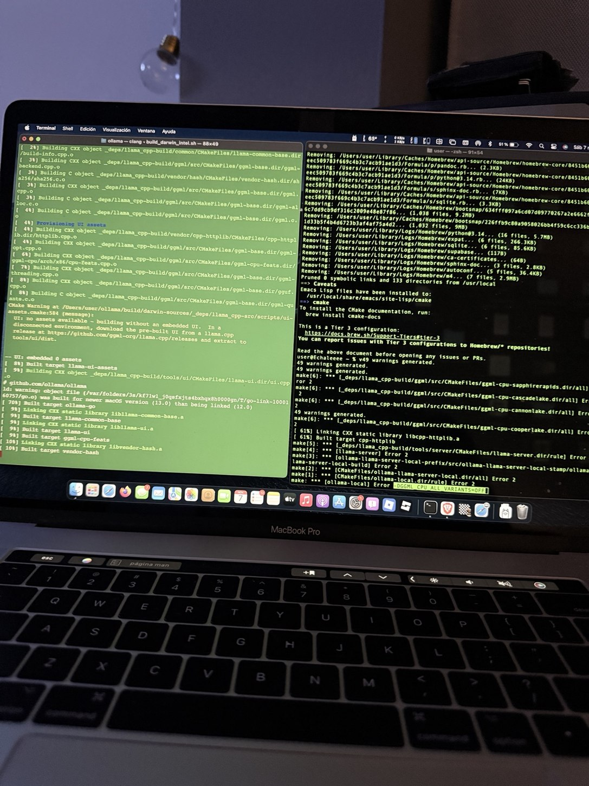](cyber-ai/intel-build.jpg) |
| Local ARTEX-based backend and PostgreSQL configuration | Working on consistency validation alongside local inference logs | Compilation and troubleshooting on Intel hardware; build errors are visible |

## MegaShop — Retail management

[Architecture notes](../showcase/enterprise-saas.md#retail-systems) · [Application repository](https://github.com/emamoreno7/Gestion-Inteligente-MegaShop)

| Dashboard | Product imports | Maintenance |
| :---: | :---: | :---: |
| [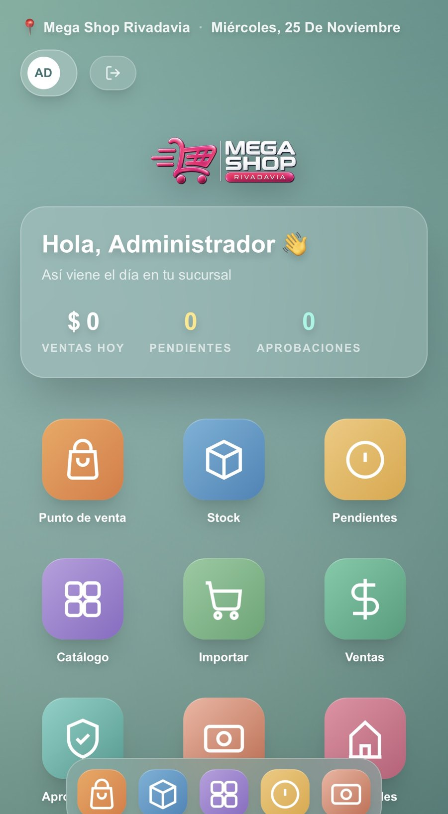](megashop/dashboard.jpg) | [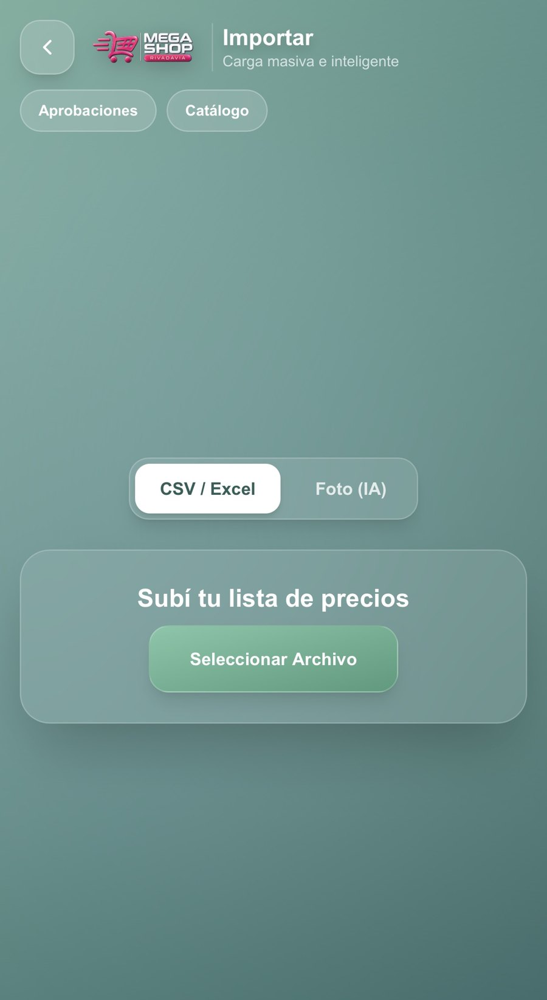](megashop/imports.jpg) | [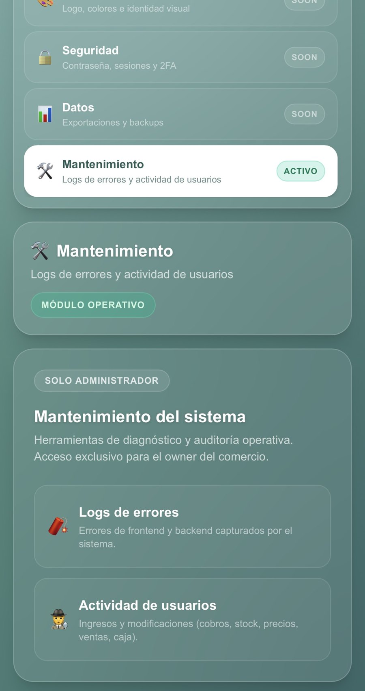](megashop/maintenance.jpg) |
| Branch overview | Spreadsheet and photo imports | Administrative diagnostics |

| Catalog | Inventory |
| :---: | :---: |
| [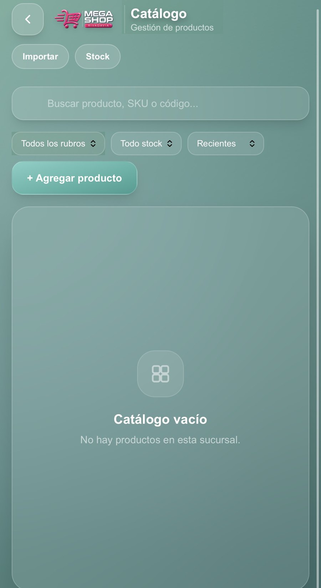](megashop/catalog.jpg) | [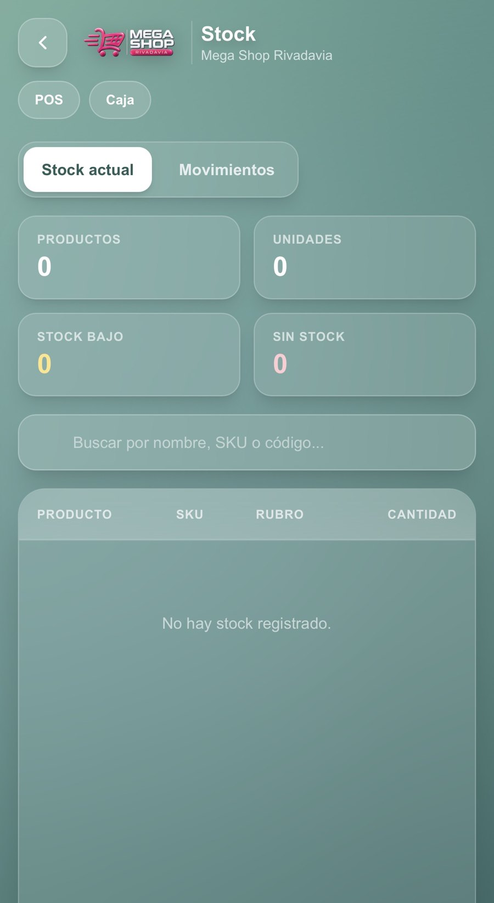](megashop/stock.jpg) |
| Product search and filters | Current stock and movement views |

These screenshots show an administrator view with an empty catalog and no recorded stock at capture time. They demonstrate the interface, not completed transactions or end-to-end validation. Browser address bars have been cropped.

## GYM OS — Gym management and training

[Architecture and database testing notes](../showcase/enterprise-saas.md#gym-os)

| Owner dashboard | Member directory | Staff management |
| :---: | :---: | :---: |
| [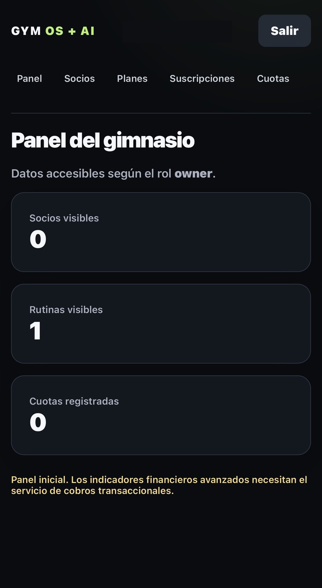](gym-os/dashboard.jpg) | [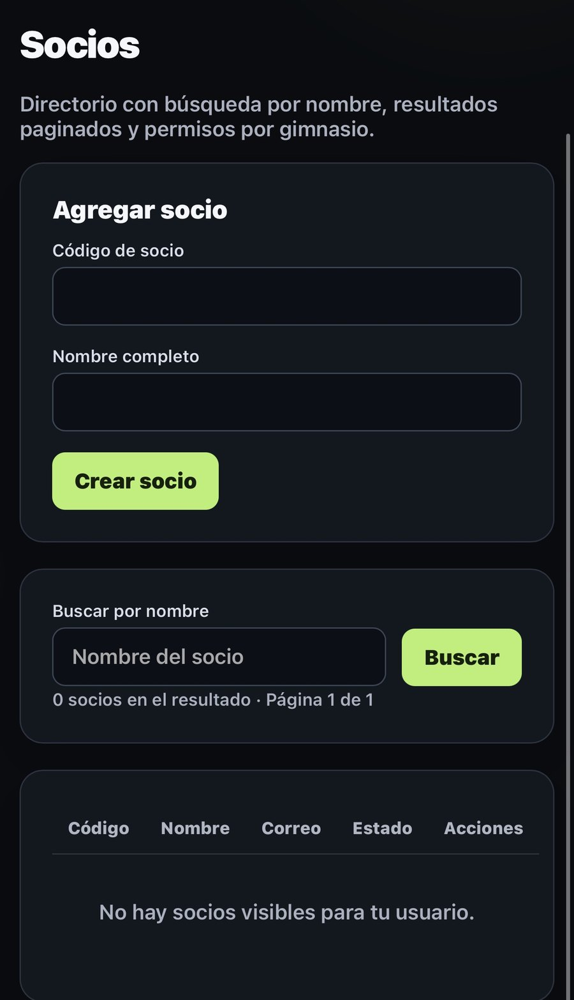](gym-os/members.jpg) | [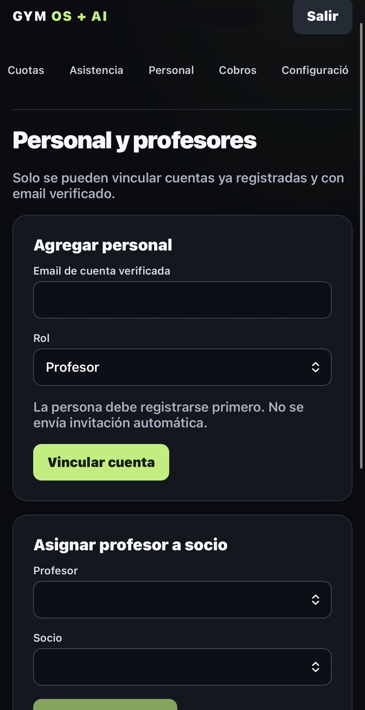](gym-os/staff.jpg) |
| Role-specific overview | Member search and pagination | Staff roles and instructor assignment |

| Training Studio | Training program |
| :---: | :---: |
| [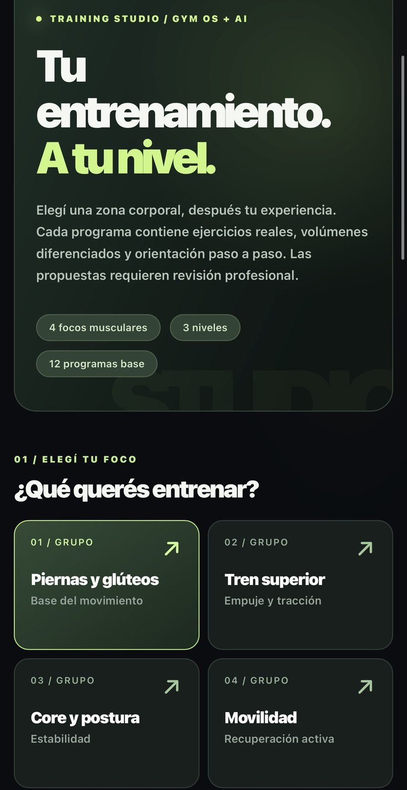](gym-os/training-studio.jpg) | [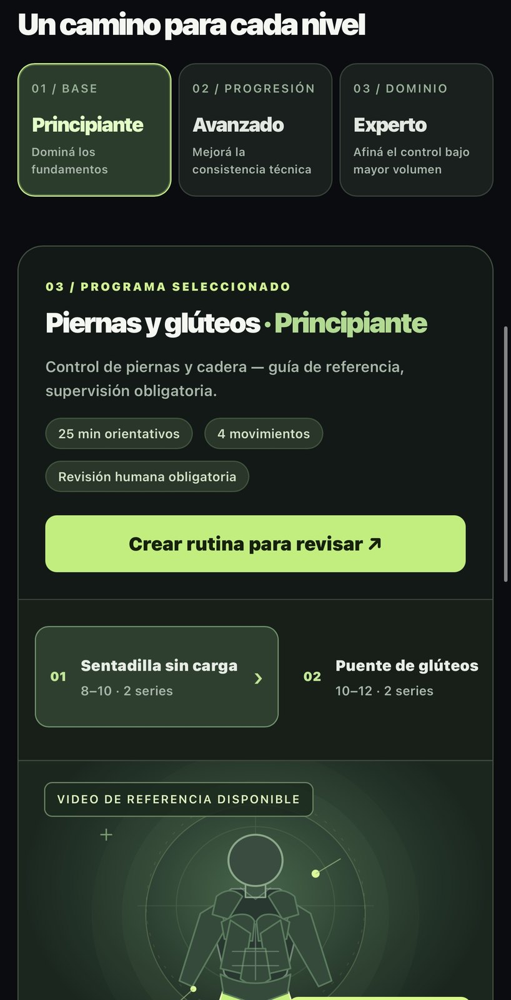](gym-os/training-program.jpg) |
| Four training focuses and three experience levels | Suggested routine for professional review |

These are screenshots from the pilot. The account name has been masked. The member directory was empty at capture time. The training module offers rule-based programs that require professional review; it is not a generative AI feature. The screenshots do not establish production readiness or demonstrate live payment or QR transactions.
