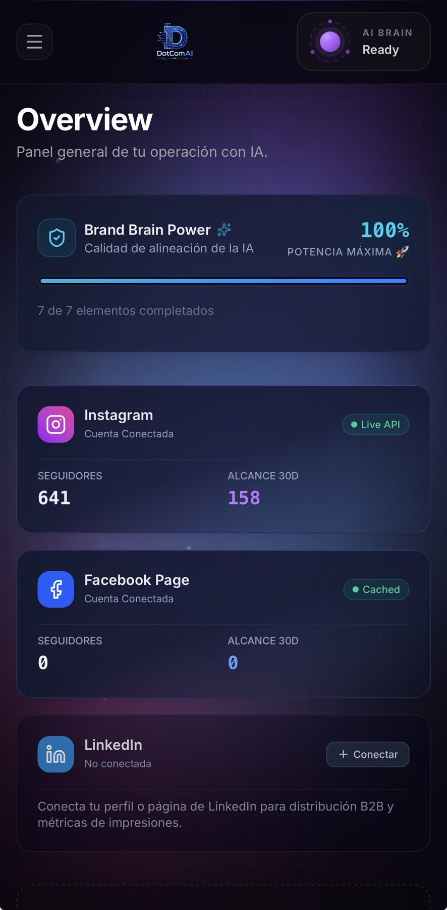
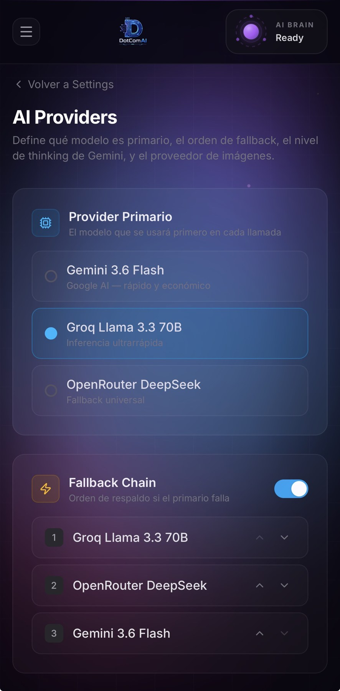

# Project screenshots

[Back to profile](../README.md)

These are screenshots and photographs from my development work, not product mockups. The screenshots have been resized for the web; the setup token and local account label in the SENTINEL-AI photograph have been masked.

## AutoPilot AI

[Architecture and workflow notes](../showcase/autopilot.md)

| Dashboard | Agent controls | Model providers |
| :---: | :---: | :---: |
|  |  |  |
| Account overview | Posting cadence and manual stop | Primary provider and fallback order |

| Brand context | Scheduling | Content library |
| :---: | :---: | :---: |
|  |  |  |
| Per-account brand configuration | Active days and time windows | Content filtering and status |

| Trends | Billing and usage |
| :---: | :---: |
|  |  |
| Topic discovery | Subscription and usage counters |

The figures and statuses in these screenshots are what the application displayed at capture time, not independently audited performance or publishing results.

## CYBER-AI / SENTINEL-AI

[Architecture and evidence validation notes](../showcase/cyber-intelligence.md)

Most of this work happens in the terminal. These photos are a record of development and setup, not a benchmark or a test report.

| Local backend setup | Consistency engine | Intel build work |
| :---: | :---: | :---: |
|  |  |  |
| Local ARTEX-based backend and PostgreSQL configuration | Working on consistency validation alongside local inference logs | Compilation and troubleshooting on Intel hardware; build errors are visible |
