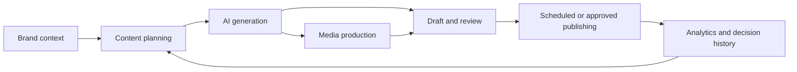

# AutoPilot AI — Autonomous Marketing Orchestration

**AI-enabled SaaS** · Active development

[Back to engineering profile](../README.md)

## Problem

Content teams must coordinate brand context, platform-specific content, approvals, media production and publishing across disconnected services. AutoPilot explores an integrated AI-assisted workflow with configurable autonomy.

Conceptual workflow, not a claim that every integration is production-ready.

## Engineering focus

- Brand-specific context and platform-aware generation.
- Agent decision modes: manual, suggestion and autonomous execution.
- Explicit approval and content lifecycle management.
- OAuth-based social account integration.
- Multimedia production using scripted video and rendering workflows.
- Audit history and centralized publication state.

## Stack

Next.js, React, TypeScript, Supabase/PostgreSQL, AI model APIs, Remotion and social platform integrations.

## Maturity

The private repository documents content workflows, Instagram and YouTube integrations, video production and analytics. End-to-end publishing, broader platform coverage and production availability are not independently verified by this showcase.

Source code, credentials, client data and private deployment details are intentionally excluded.
