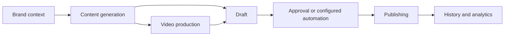

# AutoPilot AI

[Back to profile](../README.md)

I'm building AutoPilot to manage the work that normally sits between a brand's content ideas and its social media accounts: planning, writing, media generation, approval and publishing.

Rather than treating every prompt as a new conversation, the system uses stored brand context. Content can then move through drafts, review and scheduling without losing its history.

The diagram shows the intended workflow.

There are three agent modes: off, suggestions and autopilot. The reason for keeping these separate is that generating a draft and posting to a live account are very different operations. I want the user to decide where the system is allowed to act.

The application uses Next.js, TypeScript and Supabase. The repository includes Instagram and YouTube integration workflows, OAuth, and a video pipeline based on scripts and Remotion.

The product is still in development. I haven't established production readiness or verified every publishing integration end to end for this public case study. The implementation remains private.
