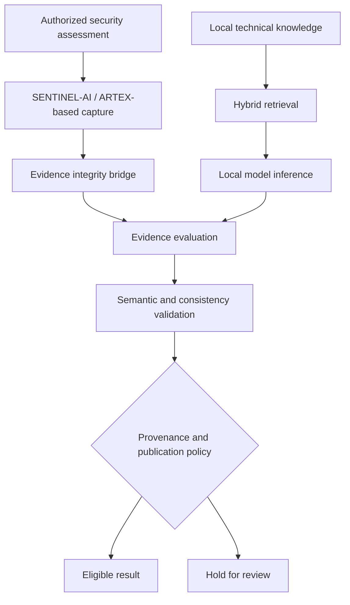

# Cyber Intelligence & Evidence Validation

**CYBER-AI / SENTINEL-AI integration** · Active research and development

[Back to engineering profile](../README.md)

## Problem

Generative security assistants can produce plausible but unsupported technical conclusions. This project investigates how local AI, technical evidence and independent validation can be combined without treating model confidence as proof.

## Architecture

Conceptual architecture; not a deployment diagram.

## Engineering decisions

- Hybrid retrieval combines lexical and vector search through reciprocal rank fusion.
- Local inference separates model execution from external AI services.
- Semantic entailment and structural consistency are distinct from evidence provenance.
- Hash verification demonstrates content integrity, not the authenticity of a network capture.
- Publication policies can withhold conclusions when evidence or provenance is insufficient.
- Authorized scope and human review remain essential for agentic security workflows.

## Validation and maturity

The work includes component tests, adversarial cases and interoperability experiments. Integration and local inference performance remain under active development. This showcase does not claim production readiness or independently certified forensic authenticity.

## Attribution

CYBER-AI is the original evidence-oriented research and engineering project. SENTINEL-AI incorporates and adapts the open-source ARTEX project; ARTEX is not claimed as original DOTCOM software. The integration, evidence contracts and validation work are the focus of this case study. Upstream: [Autumn-27/ARTEX](https://github.com/Autumn-27/ARTEX), AGPL-3.0 (as identified in the private repository's upstream documentation).

No operational targets, private datasets, source code or internal deployment configuration are included.
