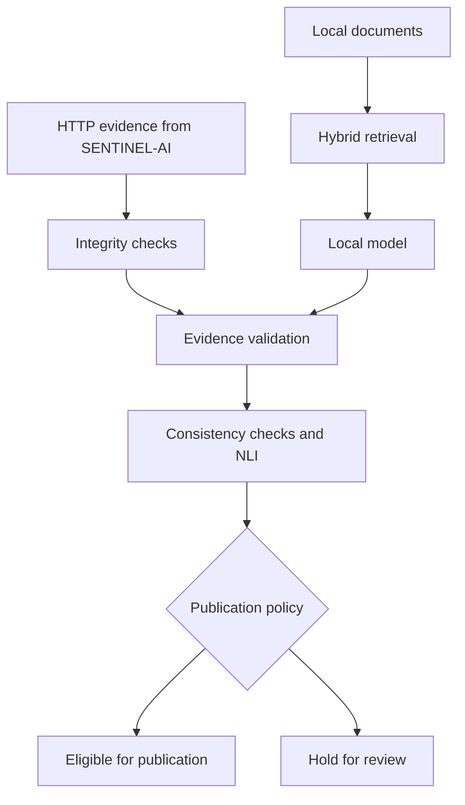

# CYBER-AI / SENTINEL-AI

Work in progress. [Back to profile](../README.md) · [Development photos](../portfolio-media/README.md#cyber-ai--sentinel-ai).

I started CYBER-AI because I wanted a local security assistant whose answers could be checked against actual technical documentation. Getting a plausible answer from a model is relatively easy. Checking whether the cited source actually supports that answer is a different problem.

The retrieval layer uses SQLite FTS5 and ChromaDB. I combine the lexical and semantic results using reciprocal rank fusion (RRF), then pass the context to a local model running through Ollama.

I'm now integrating the assistant with SENTINEL-AI, which is based on the open-source ARTEX security testing platform.

## How the pieces fit together

Simplified view of the integration.

One decision I've made is to keep semantic support, provenance and capture authenticity separate. A SHA-256 match tells me whether the content matches the recorded digest; it does not tell me whether the HTTP exchange was genuinely captured from the target. Likewise, an NLI result of SUPPORTED is not permission to publish a finding.

The HTTP integration therefore keeps findings on hold under the current publication policy. Document-based answers have a separate provenance path. I test both the expected behavior and attempts to bypass the restrictions, including missing or inconsistent evidence.

## Current status

The earlier HTTP bridge integration run recorded 44 passing tests, including 17 HTTP-specific cases. These covered request/response integrity, identity binding, malformed input and the distinction between semantic support and provenance. The 17 cases are part of the 44, not an additional suite.

The numbers come from the project's internal engineering record; they describe that revision, not a new run of the current branch. The bridge, provenance fixes and native import experiments are being developed separately rather than merged into the main release.

For the NLI experiment, I'm using a pinned ONNX model on CPU with a 512-token limit. Model identity and runtime metrics are recorded alongside the analysis. I'm still evaluating inference performance and the behavior of the integrated system. I don't consider it production-ready.

SENTINEL-AI adapts [ARTEX](https://github.com/Autumn-27/ARTEX) (AGPL-3.0, as identified in the upstream documentation). My work here concerns CYBER-AI, the integration and the evidence-validation layer, not authorship of the original ARTEX platform. Security testing is intended for authorized environments.
