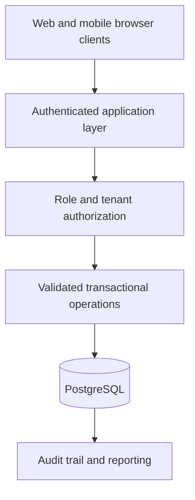

# Enterprise SaaS & Transactional Security

**Retail POS, business management and GYM OS** · Active development / pilot

[Back to engineering profile](../README.md)

## Problem

Commercial systems need predictable transactional behavior, correct authorization, auditable operations and tenant isolation. UI-level checks alone are not sufficient for enforcing these requirements.

Shared architectural principles across multiple products; individual implementations differ.

## Retail & commercial systems

- Catalog, inventory, sales, returns and cash-management workflows.
- Role-based operations and database-level security policies.
- Transaction-oriented database functions and auditable business actions.
- Public example: [Retail management repository](https://github.com/emamoreno7/Gestion-Inteligente-MegaShop).

## GYM OS

- Multi-tenant gym and branch management, memberships and subscriptions.
- Payment consistency and single-use QR access workflows.
- Supervised exercise programming and role-based access.
- Pilot stage; generative AI is a planned extension, not an implemented production feature.
- Automated checks, with end-to-end multi-tenant testing required before production.

## Engineering focus

PostgreSQL transactions, Supabase Auth and row-level security, RBAC, idempotency, schema validation, auditability, migration discipline and automated build checks.

These are architecture case studies, not certifications or guarantees of deployed security.
