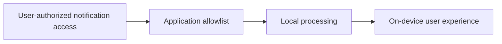

# Mobile Security & Privacy Engineering

**DOTCOM OS / EmA** · Architecture research and early prototype

[Back to engineering profile](../README.md)

## DOTCOM OS

Research into mobile data protection in the context of loss, theft and unauthorized physical access.

Design areas include encrypted storage, controlled access to sensitive data, key lifecycle management and managed-device security. Platform capabilities and restrictions must be validated before making implementation or protection claims.

## EmA

Native Android prototype exploring on-device financial notification processing and privacy-conscious user assistance.

Conceptual target architecture. The current early prototype validates notification access; complete parsing, persistence and product UI are not yet established.

## Engineering focus

- Kotlin and Jetpack Compose.
- Explicit permissions and application allowlists.
- Data minimization and on-device processing.
- Separation of sensitive financial content from diagnostic or analytics data.
- Physical-device testing and careful treatment of platform guarantees.

This case study separates intended privacy properties from implemented and tested behavior. No private app data or source code is included.
